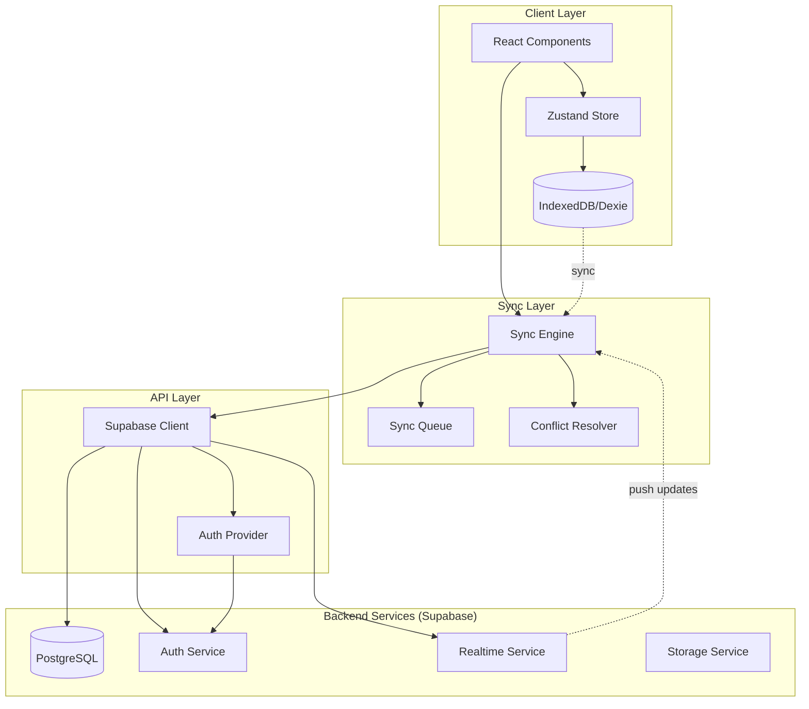
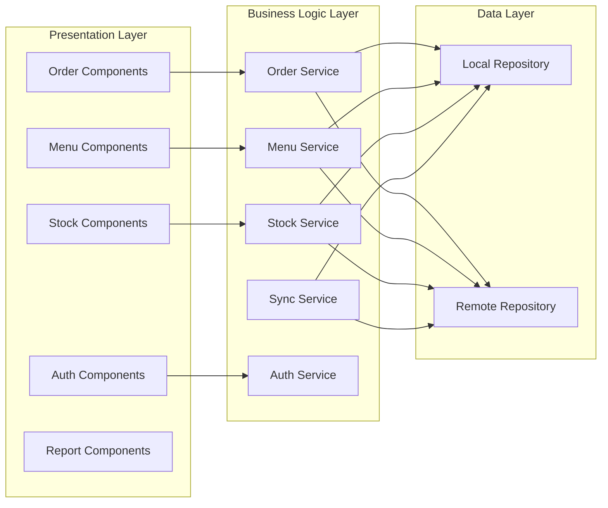
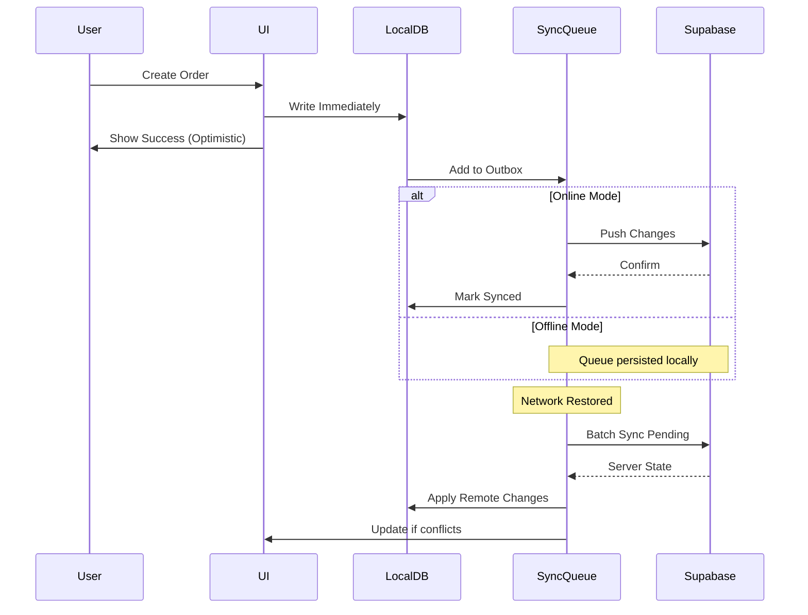

# Design Document: Papa Bolotas Webapp

## Overview

The Papa Bolotas Webapp is a Progressive Web Application (PWA) that modernizes the existing desktop POS system into a responsive, cloud-enabled solution with offline-first capabilities. The application enables restaurant staff to process orders, manage inventory, and generate reports across desktop, tablet, and mobile devices, maintaining full functionality even without internet connectivity.

### Core Design Principles

1. **Offline-First Architecture**: Data lives on the device first, ensuring uninterrupted operation regardless of network conditions
2. **Progressive Enhancement**: Start with core functionality and enhance with features as capabilities allow
3. **Optimistic UI**: Provide instant feedback to user actions, syncing in the background
4. **Eventual Consistency**: Accept temporary data divergence between devices, resolving conflicts automatically
5. **Security by Design**: Implement defense-in-depth with authentication, authorization, input validation, and secure communication

### Key Technical Decisions

- **React + TypeScript**: Type-safe component development with robust tooling
- **Supabase**: Unified backend providing PostgreSQL database, authentication, and real-time subscriptions
- **Dexie.js**: Reactive IndexedDB wrapper for local persistence with observable queries
- **Zustand**: Lightweight state management for UI state and synchronization coordination
- **Tailwind CSS + shadcn/ui**: Utility-first styling with accessible, customizable components
- **Vite**: Fast development with optimized production builds and PWA plugin support
- **Netlify/Vercel**: Edge-optimized hosting with automatic HTTPS and deployment from Git

## Architecture

### System Architecture Diagram



### Component Architecture



### Online/Offline Sync Flow



## Components and Interfaces

### Core Components

#### 1. Authentication Components

**LoginForm**
- Purpose: User authentication interface
- Props: `onSuccess: () => void`, `onError: (error: Error) => void`
- State: `username`, `password`, `isLoading`, `error`
- Key Methods: `handleLogin()`, `validateCredentials()`

**ProtectedRoute**
- Purpose: Route guard requiring authentication
- Props: `children: ReactNode`, `redirectTo: string`
- Behavior: Checks session, redirects if unauthenticated

#### 2. Order Management Components

**OrderPanel**
- Purpose: Main order creation interface
- Props: `sessionId: string`
- State: `currentOrder`, `selectedItems`, `observations`
- Key Methods: `addItem()`, `removeItem()`, `registerOrder()`, `registerComplimentary()`, `clearOrder()`

**OrderHistory**
- Purpose: Display completed orders for current session
- Props: `sessionId: string`, `orders: Order[]`
- Key Methods: `refreshOrders()`, `cancelOrder()`, `printReceipt()`

**ReceiptPreview**
- Purpose: Generate and display receipt
- Props: `order: Order`, `isComplimentary: boolean`
- Key Methods: `print()`, `generatePDF()`

#### 3. Menu Management Components

**MenuGrid**
- Purpose: Display menu items organized by category
- Props: `onItemSelect: (item: MenuItem) => void`, `selectedCategory?: Category`
- State: `menuItems`, `categories`, `loading`

**MenuItemEditor**
- Purpose: Add/edit menu items
- Props: `item?: MenuItem`, `onSave: (item: MenuItem) => void`
- State: `name`, `category`, `price`, `stockLevel`
- Validation: Price > 0, name non-empty

**CategoryFilter**
- Purpose: Filter menu by category
- Props: `categories: Category[]`, `onSelect: (cat: Category) => void`

#### 4. Stock Management Components

**StockDashboard**
- Purpose: Overview of all stock levels
- Props: `items: MenuItem[]`
- Features: Low stock warnings, bulk adjustment

**StockAdjustmentForm**
- Purpose: Manual stock adjustments
- Props: `item: MenuItem`, `onSave: (newLevel: number) => void`
- Validation: Non-negative integer

**LossRecordForm**
- Purpose: Record breakage/loss
- Props: `item: MenuItem`, `onRecord: (quantity: number) => void`
- Validation: Positive integer, confirmation if exceeds stock

#### 5. Reporting Components

**SalesReport**
- Purpose: Session sales summary
- Props: `sessionId: string`
- Display: Revenue, order counts, item breakdown, session duration

**CashRegisterClosure**
- Purpose: End-of-session reconciliation
- Props: `sessionId: string`
- Features: Expected vs actual cash, discrepancy calculation

### Service Layer Interfaces

#### AuthService

```typescript
interface AuthService {
  login(username: string, password: string): Promise<Session>;
  logout(): Promise<void>;
  getCurrentUser(): User | null;
  validateSession(): Promise<boolean>;
  refreshSession(): Promise<Session>;
}
```

#### OrderService

```typescript
interface OrderService {
  createOrder(items: OrderItem[], observations?: string): Promise<Order>;
  registerOrder(order: Order): Promise<Order>;
  registerComplimentary(order: Order): Promise<Order>;
  cancelOrder(orderId: string, securityCode: string): Promise<void>;
  getSessionOrders(sessionId: string): Promise<Order[]>;
  generateReceipt(orderId: string): Promise<Receipt>;
}
```

#### MenuService

```typescript
interface MenuService {
  getMenuItems(): Promise<MenuItem[]>;
  getItemsByCategory(category: Category): Promise<MenuItem[]>;
  createMenuItem(item: MenuItem): Promise<MenuItem>;
  updateMenuItem(id: string, updates: Partial<MenuItem>): Promise<MenuItem>;
  deleteMenuItem(id: string): Promise<void>;
}
```

#### StockService

```typescript
interface StockService {
  getStockLevels(): Promise<StockLevel[]>;
  adjustStock(itemId: string, newLevel: number): Promise<void>;
  recordLoss(itemId: string, quantity: number, reason: string): Promise<void>;
  decrementStock(itemId: string, quantity: number): Promise<void>;
  incrementStock(itemId: string, quantity: number): Promise<void>;
}
```

#### SyncService

```typescript
interface SyncService {
  isOnline(): boolean;
  syncNow(): Promise<SyncResult>;
  queueChange(entity: string, operation: Operation, data: any): Promise<void>;
  getQueueStatus(): QueueStatus;
  resolveCon flict(conflict: Conflict): Promise<void>;
  onSyncStateChange(callback: (state: SyncState) => void): () => void;
}
```

## Data Models

### Database Schema (PostgreSQL)

#### users table

```sql
CREATE TABLE users (
  id UUID PRIMARY KEY DEFAULT uuid_generate_v4(),
  username VARCHAR(50) UNIQUE NOT NULL,
  password_hash VARCHAR(255) NOT NULL,
  role VARCHAR(20) NOT NULL DEFAULT 'admin',
  created_at TIMESTAMPTZ DEFAULT NOW(),
  updated_at TIMESTAMPTZ DEFAULT NOW()
);

-- Add RLS policies
ALTER TABLE users ENABLE ROW LEVEL SECURITY;

CREATE POLICY "Users can view own record" ON users
  FOR SELECT USING (auth.uid() = id);
```

#### menu_items table

```sql
CREATE TABLE menu_items (
  id UUID PRIMARY KEY DEFAULT uuid_generate_v4(),
  name VARCHAR(100) NOT NULL,
  category VARCHAR(50) NOT NULL,
  price DECIMAL(10, 2) NOT NULL CHECK (price >= 0),
  stock_level INTEGER NOT NULL DEFAULT 0 CHECK (stock_level >= 0),
  is_active BOOLEAN DEFAULT TRUE,
  created_at TIMESTAMPTZ DEFAULT NOW(),
  updated_at TIMESTAMPTZ DEFAULT NOW(),
  last_modified_by UUID REFERENCES users(id),
  version INTEGER DEFAULT 1
);

-- Add indexes
CREATE INDEX idx_menu_items_category ON menu_items(category);
CREATE INDEX idx_menu_items_active ON menu_items(is_active);

-- Add RLS policies
ALTER TABLE menu_items ENABLE ROW LEVEL SECURITY;

CREATE POLICY "Authenticated users can view menu items" ON menu_items
  FOR SELECT USING (auth.role() = 'authenticated');

CREATE POLICY "Authenticated users can modify menu items" ON menu_items
  FOR ALL USING (auth.role() = 'authenticated');
```

#### orders table

```sql
CREATE TABLE orders (
  id UUID PRIMARY KEY DEFAULT uuid_generate_v4(),
  order_number INTEGER NOT NULL,
  session_id UUID NOT NULL REFERENCES sessions(id),
  total DECIMAL(10, 2) NOT NULL CHECK (total >= 0),
  is_complimentary BOOLEAN DEFAULT FALSE,
  is_cancelled BOOLEAN DEFAULT FALSE,
  observations TEXT,
  created_by UUID REFERENCES users(id),
  created_at TIMESTAMPTZ DEFAULT NOW(),
  cancelled_at TIMESTAMPTZ,
  cancelled_by UUID REFERENCES users(id),
  version INTEGER DEFAULT 1
);

-- Add indexes
CREATE INDEX idx_orders_session ON orders(session_id);
CREATE INDEX idx_orders_created_at ON orders(created_at);
CREATE INDEX idx_orders_number ON orders(order_number);

-- Add RLS policies
ALTER TABLE orders ENABLE ROW LEVEL SECURITY;

CREATE POLICY "Authenticated users can manage orders" ON orders
  FOR ALL USING (auth.role() = 'authenticated');
```

#### order_items table

```sql
CREATE TABLE order_items (
  id UUID PRIMARY KEY DEFAULT uuid_generate_v4(),
  order_id UUID NOT NULL REFERENCES orders(id) ON DELETE CASCADE,
  menu_item_id UUID NOT NULL REFERENCES menu_items(id),
  quantity INTEGER NOT NULL CHECK (quantity > 0),
  unit_price DECIMAL(10, 2) NOT NULL,
  subtotal DECIMAL(10, 2) NOT NULL,
  menu_item_name VARCHAR(100) NOT NULL -- denormalized for historical accuracy
);

-- Add indexes
CREATE INDEX idx_order_items_order ON order_items(order_id);

-- Add RLS policies
ALTER TABLE order_items ENABLE ROW LEVEL SECURITY;

CREATE POLICY "Authenticated users can manage order items" ON order_items
  FOR ALL USING (auth.role() = 'authenticated');
```

#### sessions table

```sql
CREATE TABLE sessions (
  id UUID PRIMARY KEY DEFAULT uuid_generate_v4(),
  user_id UUID NOT NULL REFERENCES users(id),
  started_at TIMESTAMPTZ DEFAULT NOW(),
  ended_at TIMESTAMPTZ,
  expected_cash DECIMAL(10, 2),
  actual_cash DECIMAL(10, 2),
  discrepancy DECIMAL(10, 2),
  is_active BOOLEAN DEFAULT TRUE,
  version INTEGER DEFAULT 1
);

-- Add indexes
CREATE INDEX idx_sessions_user ON sessions(user_id);
CREATE INDEX idx_sessions_active ON sessions(is_active);
CREATE INDEX idx_sessions_started_at ON sessions(started_at);

-- Add RLS policies
ALTER TABLE sessions ENABLE ROW LEVEL SECURITY;

CREATE POLICY "Authenticated users can manage sessions" ON sessions
  FOR ALL USING (auth.role() = 'authenticated');
```

#### stock_adjustments table

```sql
CREATE TABLE stock_adjustments (
  id UUID PRIMARY KEY DEFAULT uuid_generate_v4(),
  menu_item_id UUID NOT NULL REFERENCES menu_items(id),
  adjustment_type VARCHAR(20) NOT NULL, -- 'manual', 'order', 'cancellation', 'loss'
  quantity_change INTEGER NOT NULL,
  previous_level INTEGER NOT NULL,
  new_level INTEGER NOT NULL,
  reason TEXT,
  created_by UUID REFERENCES users(id),
  created_at TIMESTAMPTZ DEFAULT NOW()
);

-- Add indexes
CREATE INDEX idx_stock_adjustments_item ON stock_adjustments(menu_item_id);
CREATE INDEX idx_stock_adjustments_created_at ON stock_adjustments(created_at);

-- Add RLS policies
ALTER TABLE stock_adjustments ENABLE ROW LEVEL SECURITY;

CREATE POLICY "Authenticated users can view adjustments" ON stock_adjustments
  FOR SELECT USING (auth.role() = 'authenticated');

CREATE POLICY "Authenticated users can create adjustments" ON stock_adjustments
  FOR INSERT WITH CHECK (auth.role() = 'authenticated');
```

#### audit_logs table

```sql
CREATE TABLE audit_logs (
  id UUID PRIMARY KEY DEFAULT uuid_generate_v4(),
  user_id UUID REFERENCES users(id),
  action VARCHAR(50) NOT NULL,
  entity_type VARCHAR(50) NOT NULL,
  entity_id UUID,
  details JSONB,
  ip_address INET,
  created_at TIMESTAMPTZ DEFAULT NOW()
);

-- Add indexes
CREATE INDEX idx_audit_logs_user ON audit_logs(user_id);
CREATE INDEX idx_audit_logs_entity ON audit_logs(entity_type, entity_id);
CREATE INDEX idx_audit_logs_created_at ON audit_logs(created_at);
CREATE INDEX idx_audit_logs_action ON audit_logs(action);

-- Add RLS policies
ALTER TABLE audit_logs ENABLE ROW LEVEL SECURITY;

CREATE POLICY "Authenticated users can view own logs" ON audit_logs
  FOR SELECT USING (auth.uid() = user_id);
```

#### sync_metadata table (for offline sync)

```sql
CREATE TABLE sync_metadata (
  id UUID PRIMARY KEY DEFAULT uuid_generate_v4(),
  entity_type VARCHAR(50) NOT NULL,
  entity_id UUID NOT NULL,
  client_id UUID NOT NULL, -- identifies the device
  sync_status VARCHAR(20) NOT NULL, -- 'pending', 'synced', 'conflict'
  last_synced_at TIMESTAMPTZ,
  version INTEGER NOT NULL,
  created_at TIMESTAMPTZ DEFAULT NOW(),
  updated_at TIMESTAMPTZ DEFAULT NOW(),
  UNIQUE(entity_type, entity_id, client_id)
);

-- Add indexes
CREATE INDEX idx_sync_metadata_status ON sync_metadata(sync_status);
CREATE INDEX idx_sync_metadata_entity ON sync_metadata(entity_type, entity_id);
```

### TypeScript Data Models

#### Core Domain Models

```typescript
// User and Authentication
interface User {
  id: string;
  username: string;
  role: 'admin';
  createdAt: Date;
  updatedAt: Date;
}

interface Session {
  id: string;
  userId: string;
  startedAt: Date;
  endedAt?: Date;
  expectedCash?: number;
  actualCash?: number;
  discrepancy?: number;
  isActive: boolean;
  version: number;
}

interface AuthSession {
  user: User;
  accessToken: string;
  refreshToken: string;
  expiresAt: Date;
}

// Menu and Stock
enum Category {
  SANDES = 'Sandes',
  TABUAS = 'Tábuas',
  BATATAS = 'Batatas',
  DOCES = 'Doces',
  BEBIDAS = 'Bebidas'
}

interface MenuItem {
  id: string;
  name: string;
  category: Category;
  price: number;
  stockLevel: number;
  isActive: boolean;
  createdAt: Date;
  updatedAt: Date;
  lastModifiedBy?: string;
  version: number;
}

interface StockLevel {
  itemId: string;
  itemName: string;
  currentLevel: number;
  lastAdjustedAt: Date;
}

interface StockAdjustment {
  id: string;
  menuItemId: string;
  adjustmentType: 'manual' | 'order' | 'cancellation' | 'loss';
  quantityChange: number;
  previousLevel: number;
  newLevel: number;
  reason?: string;
  createdBy?: string;
  createdAt: Date;
}

// Orders
interface OrderItem {
  id: string;
  orderId: string;
  menuItemId: string;
  menuItemName: string;
  quantity: number;
  unitPrice: number;
  subtotal: number;
}

interface Order {
  id: string;
  orderNumber: number;
  sessionId: string;
  total: number;
  isComplimentary: boolean;
  isCancelled: boolean;
  observations?: string;
  items: OrderItem[];
  createdBy?: string;
  createdAt: Date;
  cancelledAt?: Date;
  cancelledBy?: string;
  version: number;
}

interface Receipt {
  orderId: string;
  orderNumber: number;
  date: Date;
  items: OrderItem[];
  total: number;
  isComplimentary: boolean;
  observations?: string;
}

// Reporting
interface SalesReport {
  sessionId: string;
  sessionStart: Date;
  sessionEnd?: Date;
  totalRevenue: number;
  completedOrders: number;
  complimentaryOrders: number;
  cancelledOrders: number;
  itemsSold: Array<{
    itemName: string;
    quantity: number;
    subtotal: number;
  }>;
}

// Sync
interface SyncQueueItem {
  id: string;
  entityType: string;
  entityId: string;
  operation: 'create' | 'update' | 'delete';
  data: any;
  timestamp: Date;
  retryCount: number;
  status: 'pending' | 'syncing' | 'synced' | 'failed';
}

interface SyncResult {
  success: boolean;
  itemsSynced: number;
  conflicts: Conflict[];
  errors: Error[];
}

interface Conflict {
  entityType: string;
  entityId: string;
  localVersion: any;
  remoteVersion: any;
  resolution?: 'local' | 'remote' | 'manual';
}

enum SyncState {
  ONLINE = 'online',
  OFFLINE = 'offline',
  SYNCING = 'syncing',
  ERROR = 'error'
}

interface QueueStatus {
  pendingItems: number;
  lastSyncAt?: Date;
  state: SyncState;
}

// Audit
interface AuditLog {
  id: string;
  userId?: string;
  action: string;
  entityType: string;
  entityId?: string;
  details?: Record<string, any>;
  ipAddress?: string;
  createdAt: Date;
}
```

### IndexedDB Schema (Dexie.js)

```typescript
import Dexie, { Table } from 'dexie';

export class PapaDB extends Dexie {
  menuItems!: Table<MenuItem, string>;
  orders!: Table<Order, string>;
  sessions!: Table<Session, string>;
  syncQueue!: Table<SyncQueueItem, string>;
  auditLogs!: Table<AuditLog, string>;
  
  constructor() {
    super('PapaBolotas');
    
    this.version(1).stores({
      menuItems: 'id, category, isActive, updatedAt',
      orders: 'id, sessionId, orderNumber, createdAt, isCancelled',
      sessions: 'id, userId, isActive, startedAt',
      syncQueue: 'id, entityType, status, timestamp',
      auditLogs: 'id, userId, entityType, createdAt, action'
    });
  }
}

export const db = new PapaDB();
```

## Error Handling

### Error Classification

#### 1. Network Errors
- **Detection**: Failed fetch, timeout, connection refused
- **Strategy**: Queue operation, switch to offline mode, retry with exponential backoff
- **User Feedback**: "Working offline - changes will sync when connection returns"

#### 2. Authentication Errors
- **Detection**: 401 Unauthorized, 403 Forbidden, expired token
- **Strategy**: Attempt token refresh, redirect to login if fails, preserve unsaved work
- **User Feedback**: "Session expired - please log in again"

#### 3. Validation Errors
- **Detection**: Client-side validation, 400 Bad Request from API
- **Strategy**: Block action, show specific field errors, prevent submission
- **User Feedback**: Field-level error messages (e.g., "Price must be greater than zero")

#### 4. Conflict Errors
- **Detection**: Version mismatch during sync, optimistic locking failure
- **Strategy**: Apply conflict resolution algorithm, prompt user if manual resolution needed
- **User Feedback**: "Data updated elsewhere - resolving..." or conflict resolution UI

#### 5. Business Logic Errors
- **Detection**: Insufficient stock, duplicate order, invalid security code
- **Strategy**: Block operation, explain reason, suggest corrective action
- **User Feedback**: "Cannot cancel order - invalid security code"

#### 6. System Errors
- **Detection**: Unhandled exceptions, database errors, out of memory
- **Strategy**: Log to error tracking service, show generic error, attempt recovery
- **User Feedback**: "Something went wrong - please try again"

### Error Handling Patterns

#### Global Error Boundary

```typescript
class ErrorBoundary extends React.Component<Props, State> {
  componentDidCatch(error: Error, errorInfo: ErrorInfo) {
    // Log to error tracking service (e.g., Sentry)
    logErrorToService(error, errorInfo);
    
    // Update UI
    this.setState({ hasError: true, error });
  }
  
  render() {
    if (this.state.hasError) {
      return <ErrorFallback error={this.state.error} onReset={this.reset} />;
    }
    return this.props.children;
  }
}
```

#### Service Layer Error Handling

```typescript
async function createOrder(items: OrderItem[]): Promise<Order> {
  try {
    // Validate input
    validateOrderItems(items);
    
    // Write to local DB first (offline-first)
    const order = await db.orders.add({
      ...orderData,
      createdAt: new Date(),
      version: 1
    });
    
    // Queue for sync
    await syncService.queueChange('orders', 'create', order);
    
    // Attempt immediate sync if online
    if (syncService.isOnline()) {
      try {
        await syncService.syncNow();
      } catch (syncError) {
        // Sync failure is non-critical - already queued
        console.warn('Immediate sync failed, will retry', syncError);
      }
    }
    
    return order;
    
  } catch (error) {
    if (error instanceof ValidationError) {
      throw new UserFacingError('Invalid order data', error.details);
    } else if (error instanceof DatabaseError) {
      throw new UserFacingError('Failed to save order locally', { retry: true });
    } else {
      throw new UserFacingError('Unexpected error creating order', { error });
    }
  }
}
```

#### User Feedback Component

```typescript
function Toast({ type, message, action }: ToastProps) {
  return (
    <div className={`toast toast-${type}`}>
      <Icon type={type} />
      <span>{message}</span>
      {action && <Button onClick={action.handler}>{action.label}</Button>}
    </div>
  );
}
```

### Retry Strategies

#### Exponential Backoff for Sync

```typescript
const RETRY_CONFIG = {
  maxAttempts: 5,
  initialDelay: 1000, // 1 second
  maxDelay: 32000, // 32 seconds
  backoffMultiplier: 2
};

async function retryWithBackoff<T>(
  fn: () => Promise<T>,
  attempt: number = 0
): Promise<T> {
  try {
    return await fn();
  } catch (error) {
    if (attempt >= RETRY_CONFIG.maxAttempts) {
      throw error;
    }
    
    const delay = Math.min(
      RETRY_CONFIG.initialDelay * Math.pow(RETRY_CONFIG.backoffMultiplier, attempt),
      RETRY_CONFIG.maxDelay
    );
    
    await sleep(delay);
    return retryWithBackoff(fn, attempt + 1);
  }
}
```

## Testing Strategy

### Testing Pyramid

```
        /\
       /E2E\      <- End-to-End: Critical user flows
      /------\
     /  INT   \   <- Integration: Service + DB interactions
    /----------\
   /   UNIT     \ <- Unit: Business logic, utilities, components
  /--------------\
```

### Unit Tests

**Scope**: Individual functions, utilities, React components in isolation

**Tools**: Vitest + React Testing Library

**Coverage Targets**:
- Business logic functions: 90%+
- React components: 80%+
- Utilities: 95%+

**Examples**:
- Price calculation functions
- Validation logic
- Date formatting utilities
- Component rendering with various props
- State management logic

**Sample Test**:
```typescript
describe('calculateOrderTotal', () => {
  it('sums item subtotals correctly', () => {
    const items = [
      { subtotal: 5.50 },
      { subtotal: 3.25 },
      { subtotal: 8.00 }
    ];
    expect(calculateOrderTotal(items)).toBe(16.75);
  });
  
  it('returns 0 for empty order', () => {
    expect(calculateOrderTotal([])).toBe(0);
  });
  
  it('handles single item', () => {
    expect(calculateOrderTotal([{ subtotal: 12.50 }])).toBe(12.50);
  });
});
```

### Integration Tests

**Scope**: Service layer interactions with databases (local and remote), API calls, sync operations

**Tools**: Vitest + Test Supabase instance + Fake IndexedDB

**Key Test Scenarios**:
- Menu item CRUD through MenuService
- Order creation with stock decrements
- Sync queue operations
- Authentication flow
- Conflict resolution

**Sample Test**:
```typescript
describe('OrderService Integration', () => {
  let testDb: PapaDB;
  let supabaseClient: SupabaseClient;
  
  beforeEach(async () => {
    testDb = new PapaDB();
    supabaseClient = createTestSupabaseClient();
    await seedTestData();
  });
  
  it('creates order and decrements stock', async () => {
    const item = await testDb.menuItems.get('item-1');
    const initialStock = item!.stockLevel;
    
    await orderService.createOrder([{
      menuItemId: 'item-1',
      quantity: 2
    }]);
    
    const updatedItem = await testDb.menuItems.get('item-1');
    expect(updatedItem!.stockLevel).toBe(initialStock - 2);
  });
  
  it('queues order for sync when offline', async () => {
    // Simulate offline
    vi.spyOn(navigator, 'onLine', 'get').mockReturnValue(false);
    
    await orderService.createOrder([{
      menuItemId: 'item-1',
      quantity: 1
    }]);
    
    const queueItems = await testDb.syncQueue.where('status').equals('pending').toArray();
    expect(queueItems).toHaveLength(1);
    expect(queueItems[0].entityType).toBe('orders');
  });
});
```

### End-to-End Tests

**Scope**: Complete user workflows from UI to database

**Tools**: Playwright

**Key User Flows**:
1. Login → Create order → Register → Print receipt
2. Login → Add menu item → Verify in menu grid
3. Login → Adjust stock → Create order → Verify stock decrement
4. Login → Cancel order → Verify stock restoration
5. Login → Work offline → Create order → Go online → Verify sync
6. Login → Close cash register → Verify session finalized

**Sample Test**:
```typescript
test('complete order flow', async ({ page }) => {
  // Login
  await page.goto('/');
  await page.fill('[name="username"]', 'admin');
  await page.fill('[name="password"]', 'password123');
  await page.click('button[type="submit"]');
  
  // Navigate to orders
  await page.waitForURL('/orders');
  
  // Add items to order
  await page.click('[data-item="sandes-leitao"]');
  await page.click('[data-item="coca-cola"]');
  
  // Verify total
  await expect(page.locator('[data-testid="order-total"]')).toHaveText('€7.50');
  
  // Register order
  await page.click('[data-action="register-order"]');
  
  // Verify success message
  await expect(page.locator('.toast')).toContainText('Order registered successfully');
  
  // Verify order appears in history
  await expect(page.locator('[data-testid="order-history"]')).toContainText('#1');
});

test('offline order sync', async ({ page, context }) => {
  await page.goto('/orders');
  
  // Go offline
  await context.setOffline(true);
  
  // Create order
  await page.click('[data-item="sandes-leitao"]');
  await page.click('[data-action="register-order"]');
  
  // Verify offline indicator
  await expect(page.locator('[data-testid="sync-status"]')).toContainText('Offline');
  
  // Go online
  await context.setOffline(false);
  
  // Wait for sync
  await expect(page.locator('[data-testid="sync-status"]')).toContainText('Synced', {
    timeout: 10000
  });
  
  // Verify order exists in remote DB
  const orders = await supabase.from('orders').select('*');
  expect(orders.data).toHaveLength(1);
});
```

### Testing Best Practices

1. **Arrange-Act-Assert**: Structure tests clearly with setup, execution, verification
2. **Test Behavior, Not Implementation**: Focus on what components/services do, not how
3. **Meaningful Test Names**: Describe the scenario and expected outcome
4. **Independent Tests**: Each test should run in isolation without affecting others
5. **Fast Feedback**: Unit tests should run in milliseconds, integration in seconds
6. **Data Factory Pattern**: Use helper functions to create consistent test data
7. **Mock External Dependencies**: Use test doubles for Supabase, network, timers
8. **Visual Regression**: Consider snapshot tests for complex UI layouts
9. **Accessibility Testing**: Include aria-label checks and keyboard navigation tests
10. **Test Coverage Reports**: Monitor coverage but prioritize critical paths over percentage

### Continuous Integration

- Run unit tests on every commit
- Run integration tests on pull requests
- Run E2E tests on staging deployment
- Fail build if any test fails or coverage drops below threshold
- Generate and publish test reports

## Low-Level Design

### Project Structure

```
papa-bolotas-webapp/
├── public/
│   ├── manifest.json              # PWA manifest
│   ├── icons/                     # App icons (192x192, 512x512)
│   ├── robots.txt
│   └── service-worker.js          # Service worker for offline support
│
├── src/
│   ├── components/                # React components
│   │   ├── auth/
│   │   │   ├── LoginForm.tsx
│   │   │   ├── ProtectedRoute.tsx
│   │   │   └── AuthProvider.tsx
│   │   ├── orders/
│   │   │   ├── OrderPanel.tsx
│   │   │   ├── OrderHistory.tsx
│   │   │   ├── OrderItem.tsx
│   │   │   ├── ReceiptPreview.tsx
│   │   │   └── CancelOrderModal.tsx
│   │   ├── menu/
│   │   │   ├── MenuGrid.tsx
│   │   │   ├── MenuItem.tsx
│   │   │   ├── MenuItemEditor.tsx
│   │   │   └── CategoryFilter.tsx
│   │   ├── stock/
│   │   │   ├── StockDashboard.tsx
│   │   │   ├── StockAdjustmentForm.tsx
│   │   │   └── LossRecordForm.tsx
│   │   ├── reports/
│   │   │   ├── SalesReport.tsx
│   │   │   └── CashRegisterClosure.tsx
│   │   ├── shared/
│   │   │   ├── Button.tsx
│   │   │   ├── Input.tsx
│   │   │   ├── Modal.tsx
│   │   │   ├── Toast.tsx
│   │   │   ├── Loading.tsx
│   │   │   ├── ErrorBoundary.tsx
│   │   │   └── SyncStatusIndicator.tsx
│   │   └── layout/
│   │       ├── AppLayout.tsx
│   │       ├── Navigation.tsx
│   │       └── Header.tsx
│   │
│   ├── services/                  # Business logic layer
│   │   ├── auth.service.ts
│   │   ├── order.service.ts
│   │   ├── menu.service.ts
│   │   ├── stock.service.ts
│   │   ├── session.service.ts
│   │   ├── sync.service.ts
│   │   └── audit.service.ts
│   │
│   ├── repositories/              # Data access layer
│   │   ├── local/
│   │   │   ├── local.repository.ts
│   │   │   ├── menu.local.ts
│   │   │   ├── order.local.ts
│   │   │   └── sync-queue.local.ts
│   │   └── remote/
│   │       ├── remote.repository.ts
│   │       ├── menu.remote.ts
│   │       ├── order.remote.ts
│   │       └── supabase.client.ts
│   │
│   ├── stores/                    # Zustand state management
│   │   ├── auth.store.ts
│   │   ├── order.store.ts
│   │   ├── menu.store.ts
│   │   ├── sync.store.ts
│   │   └── ui.store.ts
│   │
│   ├── hooks/                     # Custom React hooks
│   │   ├── useAuth.ts
│   │   ├── useOrders.ts
│   │   ├── useMenu.ts
│   │   ├── useStock.ts
│   │   ├── useSync.ts
│   │   ├── useOnlineStatus.ts
│   │   └── useToast.ts
│   │
│   ├── lib/                       # Utilities and configuration
│   │   ├── db.ts                  # Dexie.js IndexedDB setup
│   │   ├── supabase.ts            # Supabase client configuration
│   │   ├── sync-engine.ts         # Offline sync implementation
│   │   ├── conflict-resolver.ts   # Conflict resolution logic
│   │   ├── validators.ts          # Input validation functions
│   │   ├── formatters.ts          # Data formatting utilities
│   │   ├── constants.ts           # App constants
│   │   └── types.ts               # Shared TypeScript types
│   │
│   ├── pages/                     # Page components (React Router)
│   │   ├── LoginPage.tsx
│   │   ├── OrdersPage.tsx
│   │   ├── MenuPage.tsx
│   │   ├── StockPage.tsx
│   │   ├── ReportsPage.tsx
│   │   └── NotFoundPage.tsx
│   │
│   ├── styles/                    # Global styles
│   │   ├── globals.css            # Tailwind directives, CSS reset
│   │   └── variables.css          # CSS custom properties
│   │
│   ├── App.tsx                    # Root component
│   ├── main.tsx                   # Application entry point
│   ├── router.tsx                 # React Router configuration
│   └── vite-env.d.ts              # Vite type declarations
│
├── supabase/                      # Supabase configuration
│   ├── migrations/                # Database migrations
│   │   ├── 001_initial_schema.sql
│   │   ├── 002_add_rls_policies.sql
│   │   └── 003_add_indexes.sql
│   ├── seed.sql                   # Seed data for development
│   └── config.toml                # Supabase project config
│
├── tests/                         # Test files
│   ├── unit/
│   │   ├── services/
│   │   ├── utils/
│   │   └── components/
│   ├── integration/
│   │   ├── order-flow.test.ts
│   │   ├── sync.test.ts
│   │   └── auth.test.ts
│   ├── e2e/
│   │   ├── order-management.spec.ts
│   │   ├── offline-sync.spec.ts
│   │   └── cash-register.spec.ts
│   ├── fixtures/                  # Test data
│   └── helpers/                   # Test utilities
│
├── .env.example                   # Environment variables template
├── .gitignore
├── package.json
├── tsconfig.json                  # TypeScript configuration
├── vite.config.ts                 # Vite build configuration
├── tailwind.config.js             # Tailwind CSS configuration
├── playwright.config.ts           # Playwright E2E config
├── vitest.config.ts               # Vitest test config
└── README.md
```

### State Management (Zustand)

#### Auth Store

```typescript
interface AuthState {
  user: User | null;
  session: AuthSession | null;
  isAuthenticated: boolean;
  isLoading: boolean;
  login: (username: string, password: string) => Promise<void>;
  logout: () => Promise<void>;
  refreshSession: () => Promise<void>;
  setUser: (user: User | null) => void;
}

export const useAuthStore = create<AuthState>((set, get) => ({
  user: null,
  session: null,
  isAuthenticated: false,
  isLoading: false,
  
  login: async (username, password) => {
    set({ isLoading: true });
    try {
      const session = await authService.login(username, password);
      set({ 
        session, 
        user: session.user, 
        isAuthenticated: true,
        isLoading: false 
      });
    } catch (error) {
      set({ isLoading: false });
      throw error;
    }
  },
  
  logout: async () => {
    await authService.logout();
    set({ user: null, session: null, isAuthenticated: false });
  },
  
  refreshSession: async () => {
    const session = await authService.refreshSession();
    set({ session, user: session.user });
  },
  
  setUser: (user) => set({ user, isAuthenticated: !!user })
}));
```

#### Order Store

```typescript
interface OrderState {
  currentOrder: Partial<Order>;
  orders: Order[];
  isLoading: boolean;
  addItem: (item: MenuItem, quantity: number) => void;
  removeItem: (itemId: string) => void;
  setObservations: (observations: string) => void;
  registerOrder: () => Promise<Order>;
  registerComplimentary: () => Promise<Order>;
  cancelOrder: (orderId: string, securityCode: string) => Promise<void>;
  loadOrders: (sessionId: string) => Promise<void>;
  clearCurrentOrder: () => void;
}

export const useOrderStore = create<OrderState>((set, get) => ({
  currentOrder: { items: [], total: 0 },
  orders: [],
  isLoading: false,
  
  addItem: (item, quantity) => {
    const current = get().currentOrder;
    const existingItem = current.items?.find(i => i.menuItemId === item.id);
    
    let items: OrderItem[];
    if (existingItem) {
      items = current.items!.map(i => 
        i.menuItemId === item.id 
          ? { ...i, quantity: i.quantity + quantity, subtotal: (i.quantity + quantity) * i.unitPrice }
          : i
      );
    } else {
      items = [
        ...(current.items || []),
        {
          id: crypto.randomUUID(),
          menuItemId: item.id,
          menuItemName: item.name,
          quantity,
          unitPrice: item.price,
          subtotal: item.price * quantity,
          orderId: '' // Will be set on register
        }
      ];
    }
    
    const total = items.reduce((sum, i) => sum + i.subtotal, 0);
    set({ currentOrder: { ...current, items, total } });
  },
  
  removeItem: (itemId) => {
    const current = get().currentOrder;
    const items = current.items?.filter(i => i.id !== itemId) || [];
    const total = items.reduce((sum, i) => sum + i.subtotal, 0);
    set({ currentOrder: { ...current, items, total } });
  },
  
  setObservations: (observations) => {
    set({ currentOrder: { ...get().currentOrder, observations } });
  },
  
  registerOrder: async () => {
    const current = get().currentOrder;
    if (!current.items?.length) {
      throw new Error('Cannot register empty order');
    }
    
    set({ isLoading: true });
    try {
      const order = await orderService.registerOrder(current as Order);
      set({ 
        orders: [...get().orders, order],
        currentOrder: { items: [], total: 0 },
        isLoading: false
      });
      return order;
    } catch (error) {
      set({ isLoading: false });
      throw error;
    }
  },
  
  registerComplimentary: async () => {
    const current = get().currentOrder;
    if (!current.items?.length) {
      throw new Error('Cannot register empty order');
    }
    
    set({ isLoading: true });
    try {
      const order = await orderService.registerComplimentary(current as Order);
      set({ 
        orders: [...get().orders, order],
        currentOrder: { items: [], total: 0 },
        isLoading: false
      });
      return order;
    } catch (error) {
      set({ isLoading: false });
      throw error;
    }
  },
  
  cancelOrder: async (orderId, securityCode) => {
    set({ isLoading: true });
    try {
      await orderService.cancelOrder(orderId, securityCode);
      set({ 
        orders: get().orders.map(o => 
          o.id === orderId ? { ...o, isCancelled: true } : o
        ),
        isLoading: false
      });
    } catch (error) {
      set({ isLoading: false });
      throw error;
    }
  },
  
  loadOrders: async (sessionId) => {
    set({ isLoading: true });
    try {
      const orders = await orderService.getSessionOrders(sessionId);
      set({ orders, isLoading: false });
    } catch (error) {
      set({ isLoading: false });
      throw error;
    }
  },
  
  clearCurrentOrder: () => {
    set({ currentOrder: { items: [], total: 0 } });
  }
}));
```

#### Sync Store

```typescript
interface SyncState {
  isOnline: boolean;
  syncState: SyncState;
  queueStatus: QueueStatus;
  lastSyncAt?: Date;
  conflicts: Conflict[];
  syncNow: () => Promise<SyncResult>;
  resolveConflict: (conflict: Conflict, resolution: 'local' | 'remote') => Promise<void>;
  monitorConnectivity: () => void;
}

export const useSyncStore = create<SyncState>((set, get) => ({
  isOnline: navigator.onLine,
  syncState: SyncState.ONLINE,
  queueStatus: { pendingItems: 0, state: SyncState.ONLINE },
  conflicts: [],
  
  syncNow: async () => {
    if (!get().isOnline) {
      throw new Error('Cannot sync while offline');
    }
    
    set({ syncState: SyncState.SYNCING });
    try {
      const result = await syncService.syncNow();
      set({ 
        syncState: SyncState.ONLINE,
        lastSyncAt: new Date(),
        queueStatus: await syncService.getQueueStatus(),
        conflicts: result.conflicts
      });
      return result;
    } catch (error) {
      set({ syncState: SyncState.ERROR });
      throw error;
    }
  },
  
  resolveConflict: async (conflict, resolution) => {
    await syncService.resolveConflict({ ...conflict, resolution });
    set({ 
      conflicts: get().conflicts.filter(c => 
        c.entityId !== conflict.entityId || c.entityType !== conflict.entityType
      )
    });
  },
  
  monitorConnectivity: () => {
    window.addEventListener('online', () => {
      set({ isOnline: true, syncState: SyncState.ONLINE });
      get().syncNow().catch(console.error);
    });
    
    window.addEventListener('offline', () => {
      set({ isOnline: false, syncState: SyncState.OFFLINE });
    });
  }
}));
```

### Offline Synchronization Implementation

#### Sync Engine Core

```typescript
export class SyncEngine {
  private db: PapaDB;
  private supabase: SupabaseClient;
  private syncInProgress = false;
  private clientId: string;
  
  constructor(db: PapaDB, supabase: SupabaseClient) {
    this.db = db;
    this.supabase = supabase;
    this.clientId = this.getOrCreateClientId();
  }
  
  private getOrCreateClientId(): string {
    let clientId = localStorage.getItem('clientId');
    if (!clientId) {
      clientId = crypto.randomUUID();
      localStorage.setItem('clientId', clientId);
    }
    return clientId;
  }
  
  async queueChange(entityType: string, operation: Operation, data: any): Promise<void> {
    await this.db.syncQueue.add({
      id: crypto.randomUUID(),
      entityType,
      entityId: data.id,
      operation,
      data,
      timestamp: new Date(),
      retryCount: 0,
      status: 'pending'
    });
  }
  
  async syncNow(): Promise<SyncResult> {
    if (this.syncInProgress) {
      throw new Error('Sync already in progress');
    }
    
    if (!navigator.onLine) {
      throw new Error('Cannot sync while offline');
    }
    
    this.syncInProgress = true;
    const result: SyncResult = {
      success: true,
      itemsSynced: 0,
      conflicts: [],
      errors: []
    };
    
    try {
      // Phase 1: Pull remote changes
      await this.pullRemoteChanges(result);
      
      // Phase 2: Push local changes
      await this.pushLocalChanges(result);
      
      // Phase 3: Detect and resolve conflicts
      await this.detectAndResolveConflicts(result);
      
      return result;
    } catch (error) {
      result.success = false;
      result.errors.push(error as Error);
      throw error;
    } finally {
      this.syncInProgress = false;
    }
  }
  
  private async pullRemoteChanges(result: SyncResult): Promise<void> {
    // Get last sync timestamp for this client
    const lastSync = await this.getLastSyncTimestamp();
    
    // Fetch changes for each entity type
    const entityTypes = ['menu_items', 'orders', 'sessions'];
    
    for (const entityType of entityTypes) {
      const { data, error } = await this.supabase
        .from(entityType)
        .select('*')
        .gte('updated_at', lastSync.toISOString());
      
      if (error) {
        result.errors.push(new Error(`Failed to pull ${entityType}: ${error.message}`));
        continue;
      }
      
      // Apply changes to local DB
      for (const record of data || []) {
        await this.applyRemoteChange(entityType, record, result);
      }
    }
  }
  
  private async applyRemoteChange(entityType: string, record: any, result: SyncResult): Promise<void> {
    const table = this.getTableForEntity(entityType);
    const local = await table.get(record.id);
    
    if (!local) {
      // New record from remote
      await table.add(record);
      result.itemsSynced++;
    } else if (local.version < record.version) {
      // Remote is newer
      await table.update(record.id, record);
      result.itemsSynced++;
    } else if (local.version > record.version) {
      // Local is newer - potential conflict if remote also changed
      result.conflicts.push({
        entityType,
        entityId: record.id,
        localVersion: local,
        remoteVersion: record
      });
    }
  }
  
  private async pushLocalChanges(result: SyncResult): Promise<void> {
    const pendingItems = await this.db.syncQueue
      .where('status')
      .equals('pending')
      .or('status')
      .equals('failed')
      .toArray();
    
    for (const item of pendingItems) {
      try {
        await this.pushSingleChange(item);
        await this.db.syncQueue.update(item.id, { 
          status: 'synced',
          retryCount: item.retryCount 
        });
        result.itemsSynced++;
      } catch (error) {
        const newRetryCount = item.retryCount + 1;
        await this.db.syncQueue.update(item.id, { 
          status: newRetryCount > 5 ? 'failed' : 'pending',
          retryCount: newRetryCount 
        });
        result.errors.push(error as Error);
      }
    }
  }
  
  private async pushSingleChange(item: SyncQueueItem): Promise<void> {
    const table = item.entityType;
    
    switch (item.operation) {
      case 'create':
      case 'update':
        const { error: upsertError } = await this.supabase
          .from(table)
          .upsert(item.data);
        if (upsertError) throw upsertError;
        break;
        
      case 'delete':
        const { error: deleteError } = await this.supabase
          .from(table)
          .delete()
          .eq('id', item.entityId);
        if (deleteError) throw deleteError;
        break;
    }
  }
  
  private async detectAndResolveConflicts(result: SyncResult): Promise<void> {
    // Conflicts are already detected in pullRemoteChanges
    // Apply last-write-wins resolution automatically
    for (const conflict of result.conflicts) {
      await this.resolveConflictLastWriteWins(conflict);
    }
  }
  
  private async resolveConflictLastWriteWins(conflict: Conflict): Promise<void> {
    const localUpdatedAt = new Date(conflict.localVersion.updatedAt);
    const remoteUpdatedAt = new Date(conflict.remoteVersion.updated_at);
    
    if (remoteUpdatedAt > localUpdatedAt) {
      // Remote wins
      const table = this.getTableForEntity(conflict.entityType);
      await table.update(conflict.entityId, conflict.remoteVersion);
    } else {
      // Local wins - push to remote
      await this.supabase
        .from(conflict.entityType)
        .update(conflict.localVersion)
        .eq('id', conflict.entityId);
    }
  }
  
  async resolveConflict(conflict: Conflict): Promise<void> {
    if (!conflict.resolution) {
      throw new Error('Conflict resolution strategy not specified');
    }
    
    const table = this.getTableForEntity(conflict.entityType);
    
    if (conflict.resolution === 'local') {
      // Keep local, push to remote
      await this.supabase
        .from(conflict.entityType)
        .update(conflict.localVersion)
        .eq('id', conflict.entityId);
    } else {
      // Keep remote, update local
      await table.update(conflict.entityId, conflict.remoteVersion);
    }
  }
  
  private getTableForEntity(entityType: string): Table {
    switch (entityType) {
      case 'menu_items':
        return this.db.menuItems;
      case 'orders':
        return this.db.orders;
      case 'sessions':
        return this.db.sessions;
      default:
        throw new Error(`Unknown entity type: ${entityType}`);
    }
  }
  
  private async getLastSyncTimestamp(): Promise<Date> {
    // Get most recent sync timestamp from local metadata
    const lastSync = localStorage.getItem('lastSyncTimestamp');
    return lastSync ? new Date(lastSync) : new Date(0);
  }
  
  isOnline(): boolean {
    return navigator.onLine;
  }
  
  async getQueueStatus(): Promise<QueueStatus> {
    const pendingItems = await this.db.syncQueue
      .where('status')
      .equals('pending')
      .count();
    
    const lastSyncAt = localStorage.getItem('lastSyncTimestamp');
    
    return {
      pendingItems,
      lastSyncAt: lastSyncAt ? new Date(lastSyncAt) : undefined,
      state: this.isOnline() ? SyncState.ONLINE : SyncState.OFFLINE
    };
  }
}
```

#### Real-Time Subscriptions

```typescript
export class RealtimeSync {
  private supabase: SupabaseClient;
  private db: PapaDB;
  private subscriptions: Map<string, RealtimeChannel> = new Map();
  
  constructor(supabase: SupabaseClient, db: PapaDB) {
    this.supabase = supabase;
    this.db = db;
  }
  
  subscribeToMenuItems(): void {
    const channel = this.supabase
      .channel('menu-items-changes')
      .on(
        'postgres_changes',
        { event: '*', schema: 'public', table: 'menu_items' },
        async (payload) => {
          await this.handleMenuItemChange(payload);
        }
      )
      .subscribe();
    
    this.subscriptions.set('menu_items', channel);
  }
  
  subscribeToOrders(): void {
    const channel = this.supabase
      .channel('orders-changes')
      .on(
        'postgres_changes',
        { event: '*', schema: 'public', table: 'orders' },
        async (payload) => {
          await this.handleOrderChange(payload);
        }
      )
      .subscribe();
    
    this.subscriptions.set('orders', channel);
  }
  
  private async handleMenuItemChange(payload: any): Promise<void> {
    const { eventType, new: newRecord, old: oldRecord } = payload;
    
    switch (eventType) {
      case 'INSERT':
      case 'UPDATE':
        await this.db.menuItems.put(newRecord);
        break;
      case 'DELETE':
        await this.db.menuItems.delete(oldRecord.id);
        break;
    }
  }
  
  private async handleOrderChange(payload: any): Promise<void> {
    const { eventType, new: newRecord, old: oldRecord } = payload;
    
    switch (eventType) {
      case 'INSERT':
      case 'UPDATE':
        await this.db.orders.put(newRecord);
        break;
      case 'DELETE':
        await this.db.orders.delete(oldRecord.id);
        break;
    }
  }
  
  unsubscribeAll(): void {
    this.subscriptions.forEach(channel => {
      this.supabase.removeChannel(channel);
    });
    this.subscriptions.clear();
  }
}
```

### Security Implementation

#### Authentication Flow

```typescript
export class AuthService {
  private supabase: SupabaseClient;
  private db: PapaDB;
  
  constructor(supabase: SupabaseClient, db: PapaDB) {
    this.supabase = supabase;
    this.db = db;
  }
  
  async login(username: string, password: string): Promise<AuthSession> {
    // Input validation
    if (!username || !password) {
      throw new ValidationError('Username and password required');
    }
    
    if (password.length < 8) {
      throw new ValidationError('Password must be at least 8 characters');
    }
    
    // Audit log
    await this.logAuthAttempt(username, 'login_attempt');
    
    try {
      // Authenticate with Supabase
      const { data, error } = await this.supabase.auth.signInWithPassword({
        email: `${username}@papabolotas.local`, // Convert username to email format
        password
      });
      
      if (error) {
        await this.logAuthAttempt(username, 'login_failed', error.message);
        throw new AuthError('Invalid credentials');
      }
      
      // Create session
      const session: AuthSession = {
        user: {
          id: data.user!.id,
          username,
          role: 'admin',
          createdAt: new Date(data.user!.created_at),
          updatedAt: new Date()
        },
        accessToken: data.session!.access_token,
        refreshToken: data.session!.refresh_token,
        expiresAt: new Date(data.session!.expires_at! * 1000)
      };
      
      // Store in local storage for persistence
      localStorage.setItem('authSession', JSON.stringify(session));
      
      await this.logAuthAttempt(username, 'login_success');
      
      return session;
    } catch (error) {
      await this.logAuthAttempt(username, 'login_error', (error as Error).message);
      throw error;
    }
  }
  
  async logout(): Promise<void> {
    const { error } = await this.supabase.auth.signOut();
    if (error) {
      console.error('Logout error:', error);
    }
    
    localStorage.removeItem('authSession');
    await this.logAuthAttempt('unknown', 'logout');
  }
  
  getCurrentUser(): User | null {
    const sessionData = localStorage.getItem('authSession');
    if (!sessionData) return null;
    
    try {
      const session: AuthSession = JSON.parse(sessionData);
      
      // Check if session expired
      if (new Date() > new Date(session.expiresAt)) {
        this.logout();
        return null;
      }
      
      return session.user;
    } catch {
      return null;
    }
  }
  
  async validateSession(): Promise<boolean> {
    const { data, error } = await this.supabase.auth.getSession();
    return !error && !!data.session;
  }
  
  async refreshSession(): Promise<AuthSession> {
    const { data, error } = await this.supabase.auth.refreshSession();
    
    if (error || !data.session) {
      throw new AuthError('Session refresh failed');
    }
    
    const session: AuthSession = {
      user: this.getCurrentUser()!,
      accessToken: data.session.access_token,
      refreshToken: data.session.refresh_token,
      expiresAt: new Date(data.session.expires_at! * 1000)
    };
    
    localStorage.setItem('authSession', JSON.stringify(session));
    
    return session;
  }
  
  private async logAuthAttempt(
    username: string, 
    action: string, 
    details?: string
  ): Promise<void> {
    try {
      await this.db.auditLogs.add({
        id: crypto.randomUUID(),
        userId: undefined,
        action,
        entityType: 'auth',
        details: { username, ...(details && { error: details }) },
        createdAt: new Date()
      });
    } catch (error) {
      console.error('Failed to log auth attempt:', error);
    }
  }
}
```

#### Input Sanitization and Validation

```typescript
export class Validator {
  static sanitizeString(input: string): string {
    // Remove potential XSS vectors
    return input
      .replace(/</g, '&lt;')
      .replace(/>/g, '&gt;')
      .replace(/"/g, '&quot;')
      .replace(/'/g, '&#x27;')
      .replace(/\//g, '&#x2F;');
  }
  
  static validateMenuItemName(name: string): void {
    if (!name || name.trim().length === 0) {
      throw new ValidationError('Menu item name cannot be empty');
    }
    
    if (name.length > 100) {
      throw new ValidationError('Menu item name too long (max 100 characters)');
    }
  }
  
  static validatePrice(price: number): void {
    if (typeof price !== 'number' || isNaN(price)) {
      throw new ValidationError('Price must be a number');
    }
    
    if (price < 0) {
      throw new ValidationError('Price cannot be negative');
    }
    
    if (price > 999999.99) {
      throw new ValidationError('Price exceeds maximum value');
    }
    
    // Check for at most 2 decimal places
    if (!/^\d+(\.\d{1,2})?$/.test(price.toString())) {
      throw new ValidationError('Price can have at most 2 decimal places');
    }
  }
  
  static validateStockLevel(level: number): void {
    if (typeof level !== 'number' || isNaN(level)) {
      throw new ValidationError('Stock level must be a number');
    }
    
    if (!Number.isInteger(level)) {
      throw new ValidationError('Stock level must be an integer');
    }
    
    if (level < 0) {
      throw new ValidationError('Stock level cannot be negative');
    }
  }
  
  static validateUsername(username: string): void {
    if (!username || username.trim().length === 0) {
      throw new ValidationError('Username cannot be empty');
    }
    
    if (username.length < 3) {
      throw new ValidationError('Username must be at least 3 characters');
    }
    
    if (username.length > 50) {
      throw new ValidationError('Username too long (max 50 characters)');
    }
    
    if (!/^[a-zA-Z0-9_-]+$/.test(username)) {
      throw new ValidationError('Username can only contain letters, numbers, hyphens, and underscores');
    }
  }
  
  static validatePassword(password: string): void {
    if (!password) {
      throw new ValidationError('Password cannot be empty');
    }
    
    if (password.length < 8) {
      throw new ValidationError('Password must be at least 8 characters');
    }
    
    if (!/[a-zA-Z]/.test(password)) {
      throw new ValidationError('Password must contain at least one letter');
    }
    
    if (!/[0-9]/.test(password)) {
      throw new ValidationError('Password must contain at least one number');
    }
  }
  
  static validateSecurityCode(code: string): void {
    if (!/^\d{4,6}$/.test(code)) {
      throw new ValidationError('Security code must be 4-6 digits');
    }
  }
}
```

#### CSRF Protection

```typescript
export class CSRFProtection {
  private static TOKEN_HEADER = 'X-CSRF-Token';
  private static TOKEN_STORAGE_KEY = 'csrfToken';
  
  static generateToken(): string {
    const token = crypto.randomUUID();
    sessionStorage.setItem(this.TOKEN_STORAGE_KEY, token);
    return token;
  }
  
  static getToken(): string | null {
    return sessionStorage.getItem(this.TOKEN_STORAGE_KEY);
  }
  
  static attachTokenToRequest(config: RequestInit): RequestInit {
    const token = this.getToken();
    if (token) {
      return {
        ...config,
        headers: {
          ...config.headers,
          [this.TOKEN_HEADER]: token
        }
      };
    }
    return config;
  }
  
  static validateToken(receivedToken: string): boolean {
    const storedToken = this.getToken();
    return storedToken !== null && storedToken === receivedToken;
  }
}
```

#### Rate Limiting (Client-Side)

```typescript
export class RateLimiter {
  private attempts: Map<string, number[]> = new Map();
  
  constructor(
    private maxAttempts: number,
    private windowMs: number
  ) {}
  
  canProceed(key: string): boolean {
    const now = Date.now();
    const attempts = this.attempts.get(key) || [];
    
    // Remove attempts outside the time window
    const validAttempts = attempts.filter(timestamp => 
      now - timestamp < this.windowMs
    );
    
    if (validAttempts.length >= this.maxAttempts) {
      return false;
    }
    
    validAttempts.push(now);
    this.attempts.set(key, validAttempts);
    
    return true;
  }
  
  getRemainingAttempts(key: string): number {
    const now = Date.now();
    const attempts = this.attempts.get(key) || [];
    const validAttempts = attempts.filter(timestamp => 
      now - timestamp < this.windowMs
    );
    
    return Math.max(0, this.maxAttempts - validAttempts.length);
  }
  
  reset(key: string): void {
    this.attempts.delete(key);
  }
}

// Usage: Limit login attempts
const loginRateLimiter = new RateLimiter(5, 15 * 60 * 1000); // 5 attempts per 15 minutes
```

### PWA Configuration

#### Service Worker

```typescript
// public/service-worker.js
const CACHE_NAME = 'papa-bolotas-v1';
const STATIC_ASSETS = [
  '/',
  '/index.html',
  '/assets/index.js',
  '/assets/index.css',
  '/manifest.json',
  '/icons/icon-192x192.png',
  '/icons/icon-512x512.png'
];

// Install event - cache static assets
self.addEventListener('install', (event) => {
  event.waitUntil(
    caches.open(CACHE_NAME).then((cache) => {
      return cache.addAll(STATIC_ASSETS);
    })
  );
  self.skipWaiting();
});

// Activate event - clean up old caches
self.addEventListener('activate', (event) => {
  event.waitUntil(
    caches.keys().then((cacheNames) => {
      return Promise.all(
        cacheNames
          .filter((name) => name !== CACHE_NAME)
          .map((name) => caches.delete(name))
      );
    })
  );
  self.clients.claim();
});

// Fetch event - network first, fall back to cache
self.addEventListener('fetch', (event) => {
  const { request } = event;
  
  // API requests: network first
  if (request.url.includes('/api/') || request.url.includes('supabase')) {
    event.respondWith(
      fetch(request)
        .then((response) => {
          // Clone and cache successful responses
          if (response.ok) {
            const responseClone = response.clone();
            caches.open(CACHE_NAME).then((cache) => {
              cache.put(request, responseClone);
            });
          }
          return response;
        })
        .catch(() => {
          // Fall back to cached response if network fails
          return caches.match(request);
        })
    );
  } else {
    // Static assets: cache first
    event.respondWith(
      caches.match(request).then((cached) => {
        return cached || fetch(request);
      })
    );
  }
});

// Background sync for offline operations
self.addEventListener('sync', (event) => {
  if (event.tag === 'sync-orders') {
    event.waitUntil(syncPendingOrders());
  }
});

async function syncPendingOrders() {
  // Open IndexedDB and sync pending items
  // This would integrate with the SyncEngine
  console.log('Background sync triggered');
}
```

#### PWA Manifest

```json
{
  "name": "Papa Bolotas POS",
  "short_name": "Papa Bolotas",
  "description": "Sistema de Ponto de Venda para Papa Bolotas",
  "start_url": "/",
  "display": "standalone",
  "background_color": "#ffffff",
  "theme_color": "#2563eb",
  "orientation": "portrait-primary",
  "icons": [
    {
      "src": "/icons/icon-192x192.png",
      "sizes": "192x192",
      "type": "image/png",
      "purpose": "any maskable"
    },
    {
      "src": "/icons/icon-512x512.png",
      "sizes": "512x512",
      "type": "image/png",
      "purpose": "any maskable"
    }
  ],
  "screenshots": [
    {
      "src": "/screenshots/orders.png",
      "sizes": "1280x720",
      "type": "image/png",
      "form_factor": "wide"
    },
    {
      "src": "/screenshots/menu.png",
      "sizes": "750x1334",
      "type": "image/png",
      "form_factor": "narrow"
    }
  ],
  "categories": ["business", "productivity"],
  "prefer_related_applications": false
}
```

### Build and Deployment Configuration

#### Vite Configuration

```typescript
// vite.config.ts
import { defineConfig } from 'vite';
import react from '@vitejs/plugin-react';
import { VitePWA } from 'vite-plugin-pwa';
import path from 'path';

export default defineConfig({
  plugins: [
    react(),
    VitePWA({
      registerType: 'autoUpdate',
      includeAssets: ['icons/*.png', 'robots.txt'],
      manifest: {
        name: 'Papa Bolotas POS',
        short_name: 'Papa Bolotas',
        description: 'Sistema de Ponto de Venda',
        theme_color: '#2563eb',
        icons: [
          {
            src: '/icons/icon-192x192.png',
            sizes: '192x192',
            type: 'image/png'
          },
          {
            src: '/icons/icon-512x512.png',
            sizes: '512x512',
            type: 'image/png'
          }
        ]
      },
      workbox: {
        globPatterns: ['**/*.{js,css,html,ico,png,svg,json,woff2}'],
        runtimeCaching: [
          {
            urlPattern: /^https:\/\/.*\.supabase\.co\/.*/i,
            handler: 'NetworkFirst',
            options: {
              cacheName: 'supabase-cache',
              expiration: {
                maxEntries: 50,
                maxAgeSeconds: 60 * 60 * 24 // 24 hours
              },
              cacheableResponse: {
                statuses: [0, 200]
              }
            }
          }
        ]
      }
    })
  ],
  resolve: {
    alias: {
      '@': path.resolve(__dirname, './src')
    }
  },
  build: {
    target: 'es2020',
    outDir: 'dist',
    sourcemap: true,
    rollupOptions: {
      output: {
        manualChunks: {
          'react-vendor': ['react', 'react-dom', 'react-router-dom'],
          'supabase-vendor': ['@supabase/supabase-js'],
          'ui-vendor': ['zustand', 'dexie', 'dexie-react-hooks']
        }
      }
    }
  },
  server: {
    port: 3000,
    host: true
  }
});
```

#### Environment Variables

```bash
# .env.example
VITE_SUPABASE_URL=https://your-project.supabase.co
VITE_SUPABASE_ANON_KEY=your-anon-key
VITE_SECURITY_CODE=123456
VITE_APP_VERSION=1.0.0
```

#### Netlify Configuration

```toml
# netlify.toml
[build]
  command = "npm run build"
  publish = "dist"

[[redirects]]
  from = "/*"
  to = "/index.html"
  status = 200

[[headers]]
  for = "/*"
  [headers.values]
    X-Frame-Options = "DENY"
    X-Content-Type-Options = "nosniff"
    X-XSS-Protection = "1; mode=block"
    Referrer-Policy = "strict-origin-when-cross-origin"
    Permissions-Policy = "geolocation=(), microphone=(), camera=()"
    Content-Security-Policy = "default-src 'self'; script-src 'self' 'unsafe-inline' 'unsafe-eval'; style-src 'self' 'unsafe-inline'; img-src 'self' data: https:; font-src 'self' data:; connect-src 'self' https://*.supabase.co; frame-ancestors 'none';"

[[headers]]
  for = "/assets/*"
  [headers.values]
    Cache-Control = "public, max-age=31536000, immutable"
```

## Correctness Properties

*A property is a characteristic or behavior that should hold true across all valid executions of a system—essentially, a formal statement about what the system should do. Properties serve as the bridge between human-readable specifications and machine-verifiable correctness guarantees.*

### Property 1: Valid Authentication Success

*For any* valid username and password combination, authentication SHALL succeed and grant system access with a valid session.

**Validates: Requirements 1.3**

### Property 2: Invalid Authentication Failure

*For any* invalid username or password combination, authentication SHALL fail and display an appropriate error message without granting access.

**Validates: Requirements 1.4**

### Property 3: Session Persistence

*For any* authenticated session and any sequence of system operations, the authentication state SHALL remain valid until explicit logout or session expiration.

**Validates: Requirements 1.5**

### Property 4: Logout State Clearing

*For any* authenticated session, performing logout SHALL completely clear authentication state and require re-authentication for subsequent access.

**Validates: Requirements 1.6**

### Property 5: Password Complexity Enforcement

*For any* password input, the validation SHALL correctly enforce minimum length (8 characters) and alphanumeric composition requirements.

**Validates: Requirements 1.8**

### Property 6: Offline Data Persistence

*For any* data write operation (orders, menu items, stock adjustments) while in offline mode, the data SHALL be stored in local IndexedDB and remain accessible.

**Validates: Requirements 3.3, 3.6**

### Property 7: Offline-to-Online Synchronization

*For any* set of changes made while offline, when connection is restored, all pending changes SHALL be synchronized to the remote database.

**Validates: Requirements 3.4**

### Property 8: Last-Write-Wins Conflict Resolution

*For any* pair of conflicting changes to the same entity, the change with the later timestamp SHALL be preserved in the final state.

**Validates: Requirements 3.7**

### Property 9: Menu Item Category Validity

*For any* menu item, its assigned category SHALL be one of the valid categories: Sandes, Tábuas, Batatas, Doces, or Bebidas.

**Validates: Requirements 4.1**

### Property 10: Menu Item Required Fields

*For any* menu item creation or update, if any required field (name, category, price, stock level) is missing or invalid, the operation SHALL be rejected with a validation error.

**Validates: Requirements 4.2**

### Property 11: Price Validation

*For any* price input, validation SHALL accept only positive decimal numbers with at most 2 decimal places and reject all other inputs.

**Validates: Requirements 4.3**

### Property 12: Price Update Propagation

*For any* menu item price update, all orders created after the update SHALL use the new price, while orders created before SHALL maintain the old price.

**Validates: Requirements 4.4**

### Property 13: Special Character Support

*For any* menu item name containing special characters (accents, symbols), the name SHALL be correctly stored and retrieved without data loss or corruption.

**Validates: Requirements 4.6**

### Property 14: Order Item Addition

*For any* menu item selection during order creation, the item SHALL be added to the current order with correct price and quantity.

**Validates: Requirements 5.1**

### Property 15: Order Total Calculation

*For any* order with N items, the order total SHALL equal the sum of all item subtotals (quantity × unit price).

**Validates: Requirements 5.3**

### Property 16: Order Observation Persistence

*For any* observation text added to an order, the observation SHALL be stored with the order and retrievable later.

**Validates: Requirements 5.4**

### Property 17: Order Item Removal

*For any* item in the current order, removing that item SHALL decrease the order total by the item's subtotal and remove it from the order items list.

**Validates: Requirements 5.5**

### Property 18: Order Clearing

*For any* non-empty order, invoking clear SHALL result in an empty order with zero total and no items.

**Validates: Requirements 5.6**

### Property 19: Sequential Order Numbering

*For any* sequence of orders registered within a session, the order numbers SHALL be sequential integers starting from 1 with no gaps or duplicates.

**Validates: Requirements 5.7**

### Property 20: Order Timestamp Recording

*For any* registered order, the recorded timestamp SHALL be within a few seconds of the actual registration time.

**Validates: Requirements 5.8**

### Property 21: Stock Decrement on Order

*For any* registered order containing item I with quantity Q, the stock level of item I SHALL decrease by exactly Q units.

**Validates: Requirements 5.9, 8.6**

### Property 22: Receipt Generation Integrity

*For any* registered order, the generated receipt SHALL contain all order details: order number, timestamp, all items with quantities and prices, total, and any observations.

**Validates: Requirements 5.10, 12.1-12.7**

### Property 23: Order History Completeness

*For any* order registered in the current session, that order SHALL appear in the session's order history.

**Validates: Requirements 5.11**

### Property 24: Complimentary Order Zero Total

*For any* order registered as complimentary, the order total SHALL be exactly 0.00 regardless of item prices.

**Validates: Requirements 6.2**

### Property 25: Complimentary Order Stock Impact

*For any* complimentary order containing item I with quantity Q, the stock level of item I SHALL decrease by exactly Q units, identical to regular orders.

**Validates: Requirements 6.3**

### Property 26: Complimentary Order Flagging

*For any* order registered as complimentary, the isComplimentary flag SHALL be set to true.

**Validates: Requirements 6.4**

### Property 27: Complimentary Receipt Indication

*For any* complimentary order receipt, the receipt SHALL display a total of 0.00 and include a complimentary indicator.

**Validates: Requirements 6.5**

### Property 28: Invalid Security Code Rejection

*For any* order cancellation attempt with an incorrect security code, the cancellation SHALL be denied and an error message displayed.

**Validates: Requirements 7.3**

### Property 29: Stock Restoration on Cancellation

*For any* cancelled order containing item I with quantity Q, the stock level of item I SHALL increase by exactly Q units.

**Validates: Requirements 7.5, 8.7**

### Property 30: Cancelled Order Zero Total

*For any* cancelled order, the order total SHALL be set to 0.00.

**Validates: Requirements 7.6**

### Property 31: Cancelled Order Flagging

*For any* cancelled order, the isCancelled flag SHALL be set to true.

**Validates: Requirements 7.7**

### Property 32: Cancellation Receipt Generation

*For any* cancelled order, a cancellation receipt SHALL be generated documenting the reversed order.

**Validates: Requirements 7.8**

### Property 33: Revenue Calculation Exclusions

*For any* set of orders including complimentary and cancelled orders, the calculated revenue SHALL equal the sum of totals for only non-complimentary, non-cancelled orders.

**Validates: Requirements 6.6, 7.9, 10.2**

### Property 34: Manual Stock Adjustment Persistence

*For any* manual stock level adjustment to value V for item I, the stored stock level for item I SHALL become V.

**Validates: Requirements 8.3**

### Property 35: Stock Level Validation

*For any* stock level input, validation SHALL accept non-negative integers only and reject negative numbers, non-integers, and non-numeric inputs.

**Validates: Requirements 8.4**

### Property 36: Zero Stock Warning

*For any* item with stock level of zero, attempting to add it to an order SHALL display a low-stock warning but still allow the addition.

**Validates: Requirements 8.5**

### Property 37: Loss Record Required Fields

*For any* loss record missing menu item or quantity, the record SHALL be rejected with a validation error.

**Validates: Requirements 9.2**

### Property 38: Loss Quantity Validation

*For any* loss quantity input, validation SHALL accept positive integers only and reject zero, negative numbers, non-integers, and non-numeric inputs.

**Validates: Requirements 9.3**

### Property 39: Excessive Loss Warning

*For any* loss record where quantity exceeds current stock level, a warning SHALL be displayed and confirmation required before proceeding.

**Validates: Requirements 9.4**

### Property 40: Stock Decrement on Loss

*For any* confirmed loss of quantity Q for item I, the stock level of item I SHALL decrease by exactly Q units.

**Validates: Requirements 9.5**

### Property 41: Loss Audit Logging

*For any* confirmed loss, an audit log entry SHALL be created containing timestamp, menu item ID, and loss quantity.

**Validates: Requirements 9.6**

### Property 42: Sales Statistics Real-Time Update

*For any* order operation (register, cancel), all sales statistics (revenue, order counts, item totals) SHALL update immediately to reflect the change.

**Validates: Requirements 10.8**

### Property 43: Session Record Persistence on Closure

*For any* session when closure is confirmed, the complete session record including all orders and statistics SHALL be permanently stored.

**Validates: Requirements 11.6**

### Property 44: Order Counter Reset Between Sessions

*For any* session closure, the first order in the next session SHALL have order number 1.

**Validates: Requirements 11.7**

### Property 45: Receipt Format Constraints

*For any* generated receipt, all lines SHALL fit within 32 characters width for thermal printer compatibility.

**Validates: Requirements 12.8**

### Property 46: Price List PDF Completeness

*For any* menu state when PDF generation is invoked, the resulting PDF SHALL contain all active menu items organized by category with current prices and generation date.

**Validates: Requirements 13.2-13.6**

### Property 47: Authentication Rate Limiting

*For any* series of N+1 rapid authentication attempts from the same source, if N equals the rate limit, the N+1th attempt SHALL be blocked with a rate limit error.

**Validates: Requirements 15.5**

### Property 48: Failed Authentication Audit Logging

*For any* failed authentication attempt, an audit log entry SHALL be created containing username, timestamp, and failure reason.

**Validates: Requirements 15.6**

### Property 49: Input Sanitization

*For any* user input containing potentially malicious content (script tags, SQL injection patterns), the input SHALL be sanitized before storage or processing.

**Validates: Requirements 15.8**

### Property 50: Entity Synchronization

*For any* entity modification (menu item, order, stock, session) in online mode, the change SHALL be synchronized to the remote database.

**Validates: Requirements 4.7, 8.8, 9.7**

### Property 51: Session Order Association

*For any* order registered during session S, that order SHALL be associated with session S and included in session S's statistics and history.

**Validates: Requirements 19.3, 19.4**

### Property 52: Audit Trail Completeness

*For any* system event of type E (authentication, order operation, stock adjustment, menu change), an audit log entry SHALL be created recording the event type, timestamp, user, and relevant details.

**Validates: Requirements 20.1-20.6**

